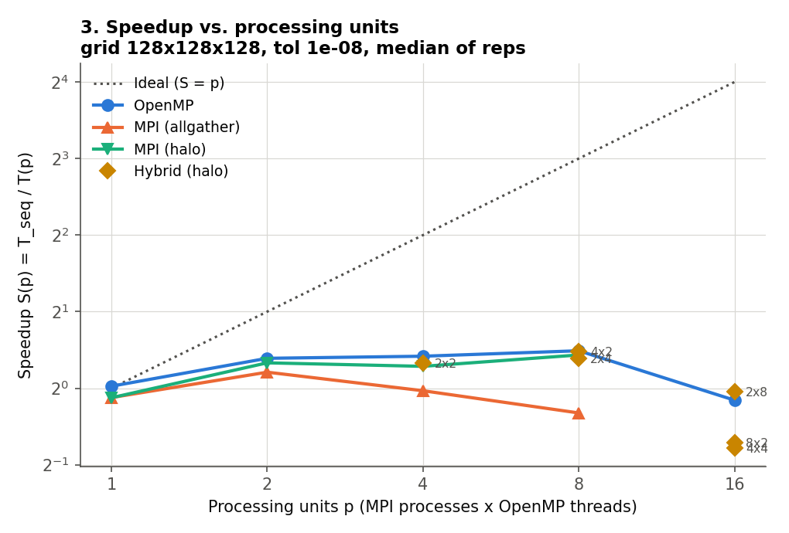
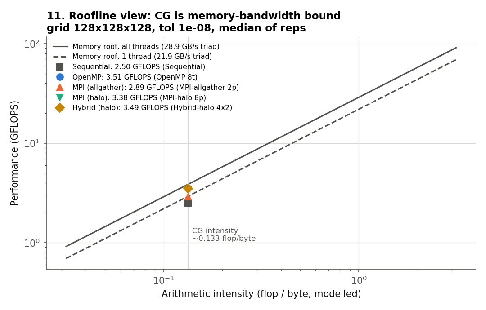

# HPCG-Performance-Analyzer

**P08 – High-Performance Conjugate-Gradient Benchmark: A New Metric for Ranking HPC Systems**

An HPCG-inspired benchmark and performance-analysis system. It solves a
sparse 3D Poisson system with the Conjugate Gradient method in four
implementations (sequential, OpenMP, MPI, hybrid MPI + OpenMP) and measures
time, GFLOPS, speedup, efficiency and communication overhead. Python scripts
turn the measurements into tables, graphs and a dashboard.

> ⚠️ **Educational implementation.** This project is *inspired by* the HPCG
> benchmark (Dongarra, Heroux and Luszczek). It is **not** the official HPCG
> code, it is not HPCG-compliant, and its numbers are **not** HPCG or TOP500
> results.

---

## Documentation map

| If you want to… | Read |
|---|---|
| **run the live demo and prepare for the viva** | [docs/DEMO_AND_VIVA_GUIDE.md](docs/DEMO_AND_VIVA_GUIDE.md) |
| build, test and run everything step by step (with expected output) | [docs/WALKTHROUGH.md](docs/WALKTHROUGH.md) |
| look up a term (CSR, SpMV, halo, roofline, efficiency…) | [docs/GLOSSARY.md](docs/GLOSSARY.md) |
| understand *why* the code is designed this way | [docs/DESIGN_DECISIONS.md](docs/DESIGN_DECISIONS.md) |
| see exact measurement rules (timing, flops, fairness) | [report/methodology.md](report/methodology.md) |
| read background and references | [report/literature_review.md](report/literature_review.md) |
| read the full academic report with results | [report/project_report.md](report/project_report.md) |
| prepare the presentation | [report/presentation_outline.md](report/presentation_outline.md) |
| see the numbers | [results/summary.md](results/summary.md) and [results/graphs/](results/graphs/) |

## Problem statement

HPL (LINPACK), the TOP500 metric, is dominated by dense, compute-bound
matrix multiplication. Most scientific codes are instead limited by sparse
memory access and communication. HPCG was proposed to measure that class of
workload. This project rebuilds HPCG's computational core (a 3D-stencil SPD
matrix, CSR SpMV, global dot products and halo exchange) to study how
shared-memory and distributed-memory parallelisation perform on a
memory-bound CG solver.

## Features

* **CSR sparse matrix** generated from the 3D 7-point Poisson stencil
  (6 on the diagonal, −1 for neighbours, Dirichlet boundaries). It is SPD
  (proved in the docs, verified in tests) and deterministic, with `b = A·1`
  so the exact solution is `x = 1`.
* **Four CG back-ends**, all using the same fused kernels and the same flop
  model:
  * `sequential`: the baseline;
  * `openmp`: `parallel for` loops with reductions;
  * `mpi`: row-block distribution with uneven splits; `MPI_Allgatherv`
    (replicated vector) **or** point-to-point **halo** exchange;
    `MPI_Allreduce` for dot products;
  * `hybrid`: MPI + OpenMP, `MPI_THREAD_FUNNELED`, with thread level
    verified.
* **Robustness**: detects breakdown, NaN, Inf and zero RHS; memory guard
  against oversized problems; collective-consistent error handling.
* **Benchmark runner** with warm-up, repetitions and the median; separate
  communication timing; true-residual and error verification; CSV output.
* **Automated campaign**: strong scaling, size sweep, weak scaling,
  convergence history, STREAM-style bandwidth probe, and hardware and
  software metadata.
* **Analysis**: speedup, efficiency, weak-scaling efficiency and a roofline
  model, with 11 graphs, `summary.csv` / `summary.md` and a static HTML
  dashboard.
* **Tests**: 10 CTest targets, including MPI tests on 1, 2, 3 and 4 ranks.

## Architecture

```
include/             public headers (common, csr_matrix, matrix_generator, cg_solver,
                     distributed, benchmark, metrics)
src/main.cpp         entry point (MPI_Init_thread)
src/matrix/          CSR utilities + Poisson generator
src/sequential/      baseline CG
src/openmp/          OpenMP CG
src/mpi/             row distribution, VectorExchange (Allgatherv | halo), MPI CG
src/hybrid/          MPI + OpenMP CG
src/benchmark/       CLI, timing, statistics, CSV, environment detection
src/tools/           stream_triad bandwidth probe
tests/               test_matrix, test_sequential, test_openmp, test_mpi (+ e2e)
scripts/             setup.sh, build.sh, run_benchmarks.sh, run_all.sh, in_docker.sh
python/              analyze.py, visualize.py, dashboard.py
docker/Dockerfile    reproducible Ubuntu 24.04 toolchain
results/             measured CSVs, graphs, dashboard, system info
report/              project report, methodology, literature review, presentation outline
```

## Mathematical overview

CG for `A x = b` (A SPD):

```
r0 = b − A x0,  p0 = r0
α = (rᵀr)/(pᵀAp);  x += αp;  r_new = r − αAp;  β = (r_newᵀr_new)/(rᵀr);  p = r_new + βp
stop when ||r||/||b|| ≤ tol or after max_iters
```

* Flops per iteration: `2·nnz + 10n`; setup: `2·nnz + 5n`.
* Speedup: `S(p) = T_seq / T(p)`.
* Efficiency: `E(p) = S(p)/p × 100 %`, with `p = processes × threads`.
* GFLOPS: `flops / (time·10⁹)`.

See [report/methodology.md](report/methodology.md) for the details.

## Technology stack

C++17 · g++ · OpenMP · Open MPI · CMake/CTest · Python 3 (NumPy, Pandas, Matplotlib) · Docker (optional)

## Prerequisites

Native Linux (Ubuntu/Debian):

```bash
sudo apt install build-essential cmake openmpi-bin libopenmpi-dev python3 python3-numpy python3-pandas python3-matplotlib
```

```bash
bash scripts/setup.sh
```

`setup.sh` checks every dependency and prints install hints.

**Windows or macOS without a Linux toolchain:** install Docker Desktop and
use the bundled image. `scripts/in_docker.sh` builds it on first use and
runs any command inside it with the project mounted at `/work`.

```bash
docker build -t hpcg-analyzer -f docker/Dockerfile docker
```

```bash
bash scripts/in_docker.sh bash scripts/run_all.sh
```

## Build

```bash
bash scripts/build.sh --clean
```

This is equivalent to:

```bash
cmake -S . -B build -DCMAKE_BUILD_TYPE=Release && cmake --build build -j
```

CMake options:

* `-DHPCG_ENABLE_MPI=OFF` builds without MPI (the mpi and hybrid modes are
  then unavailable);
* `-DHPCG_ENABLE_OPENMP=OFF` builds without OpenMP;
* `-DHPCG_NATIVE=ON` adds `-march=native`;
* `-DHPCG_MPIEXEC_EXTRA_FLAGS=--oversubscribe` is for tests on machines with
  fewer than 4 cores.

## Tests

```bash
cd build && ctest --output-on-failure
```

## Running

```bash
./build/hpcg_benchmark --help
```

```bash
./build/hpcg_benchmark --mode sequential --grid 30
```

```bash
OMP_NUM_THREADS=4 ./build/hpcg_benchmark --mode openmp --grid 30
```

```bash
mpirun -np 4 ./build/hpcg_benchmark --mode mpi --grid 30
```

```bash
mpirun -np 4 ./build/hpcg_benchmark --mode mpi --grid 30 --comm halo
```

```bash
OMP_NUM_THREADS=2 mpirun --bind-to none -np 2 ./build/hpcg_benchmark --mode hybrid --grid 30
```

Useful options:

| Option | Effect |
|---|---|
| `--nx/--ny/--nz` | anisotropic grid |
| `--tol` | convergence tolerance (`0` = run a fixed number of iterations) |
| `--max-iters` | iteration limit |
| `--reps`, `--warmup` | timed repetitions (median reported) and untimed warm-up solves |
| `--threads` | OpenMP thread count |
| `--csv FILE` | append a result row to FILE |
| `--history FILE` | write the residual history |
| `--info` | print build and hardware information |
| `--force` | skip the memory guard |

Each run prints a `RESULT` line with: mode, grid, rows, nnz, processes,
threads, iterations, status, relative and true residual, max error, median
time, communication fraction, GFLOPS and memory.

## Benchmarks

```bash
bash scripts/run_all.sh
```

This is the full pipeline: checks, clean build, tests, benchmarks, analysis,
graphs and dashboard. It takes about 15–25 minutes on a laptop.

```bash
QUICK=1 bash scripts/run_all.sh
```

This is a 1-minute smoke run.

```bash
GRID=96 REPS=3 bash scripts/run_benchmarks.sh
```

This runs only the campaign, with custom parameters.

```bash
python3 python/analyze.py && python3 python/visualize.py && python3 python/dashboard.py
```

This re-runs the analysis on the existing CSV.

Outputs in `results/`:

| File | Contents |
|---|---|
| `benchmark.csv` | one row per configuration |
| `summary.csv`, `summary.md` | derived metrics |
| `weak_scaling.csv` | weak-scaling metrics |
| `bandwidth.csv` | measured memory bandwidth |
| `convergence_g*.csv` | residual histories |
| `system_info.txt` | hardware and software metadata |
| `run_status.csv` | exit code of every run, including skipped runs |
| `test_results.txt` | CTest output |
| `graphs/*.png` | the graphs |
| `dashboard.html` | the dashboard |

<!-- README-RESULTS-START -->
## Results

These are measured values on an Intel Core 7 240H laptop (16 logical CPUs)
inside the Ubuntu container. Full tables are in
[results/summary.md](results/summary.md) and the analysis is in report §19.

**Strong scaling, 128³ grid** (2,097,152 rows, 14,581,760 non-zeros,
tol 1e−8). All runs took 296 iterations, with true relative residual
9.79e−9.

| Configuration | Median time (s) | Speedup | Efficiency | GFLOPS | Comm. share |
|---|---|---|---|---|---|
| Sequential | 5.953 | 1.00 | 100 % | 2.50 | – |
| OpenMP 8 threads | **4.240** | **1.40** | 17.5 % | 3.51 | – |
| MPI Allgatherv 8 procs | 7.446 | 0.80 | 10.0 % | 2.00 | 50.6 % |
| MPI halo 8 procs | 4.405 | 1.35 | 16.9 % | 3.38 | 11.5 % |
| Hybrid halo 4×2 | 4.269 | 1.39 | 17.4 % | 3.49 | 5.1 % |

* The measured STREAM-style triad bandwidth is 21.9 GB/s (1 thread) and
  28.9 GB/s (best), only 1.32× apart. CG streams about 90 % of that, so
  the solver is **memory-bandwidth bound** and the speedup ceiling is the
  bandwidth ceiling (see the roofline graph).
* Halo exchange is 1.69× faster than replicated-vector Allgatherv at 8
  processes.
* Cache-resident sizes (≤ 64³) show misleading speedups of up to 3.9×.

Graphs (`results/graphs/`): `01_time_vs_threads`, `02_time_vs_mpi_procs`,
`03_speedup`, `04_efficiency`, `05_gflops_comparison`,
`06_implementation_comparison`, `07_comm_overhead`, `08_perf_vs_size`,
`09_weak_scaling`, `10_convergence`, `11_roofline`. Open
`results/dashboard.html` for everything on one page.



<!-- README-RESULTS-END -->

## Research contribution

* A compact, fully tested CG code that keeps HPCG's essential
  memory-bound and communication-bound kernels and is readable in an
  afternoon.
* A side-by-side, same-problem comparison of replicated-vector (Allgatherv)
  and halo-exchange MPI communication, with separately measured exchange
  and reduction time.
* A roofline explanation of the results using a measured bandwidth and an
  explicit traffic model, showing why core count is not the limiting
  factor.
* A documented observation that OpenMP reductions are not bit-reproducible
  run to run.

Details: [report/project_report.md](report/project_report.md) · [methodology](report/methodology.md) · [literature review](report/literature_review.md) · [presentation outline](report/presentation_outline.md)

## Team members and contributions

| Member | Roll no. | Contribution |
|---|---|---|
| _Name 1_ | _…_ | _e.g. matrix generator, sequential CG, tests_ |
| _Name 2_ | _…_ | _e.g. OpenMP implementation, benchmarking_ |
| _Name 3_ | _…_ | _e.g. MPI / hybrid implementation_ |
| _Name 4_ | _…_ | _e.g. analysis, report, presentation_ |

## References

1. J. Dongarra, M. A. Heroux, *Toward a New Metric for Ranking High Performance Computing Systems*, Sandia Report SAND2013-4744, 2013.
2. J. Dongarra, M. A. Heroux, P. Luszczek, "High-performance conjugate-gradient benchmark: A new metric for ranking high-performance computing systems", *Int. J. High Performance Computing Applications* 30(1), 3–10, 2016.
3. J. Dongarra, M. A. Heroux, P. Luszczek, "A new metric for ranking high-performance computing systems", *National Science Review* 3(1), 30–35, 2016.
4. M. R. Hestenes, E. Stiefel, "Methods of Conjugate Gradients for Solving Linear Systems", *J. Res. Nat. Bur. Standards* 49(6), 1952.
5. Y. Saad, *Iterative Methods for Sparse Linear Systems*, 2nd ed., SIAM, 2003.
6. HPCG official site <https://www.hpcg-benchmark.org> and reference code <https://github.com/hpcg-benchmark/hpcg>.
7. S. Williams, A. Waterman, D. Patterson, "Roofline: An Insightful Visual Performance Model for Multicore Architectures", *Commun. ACM* 52(4), 2009.

The full list is in the project report, §24.

## License

MIT – see [LICENSE](LICENSE).
